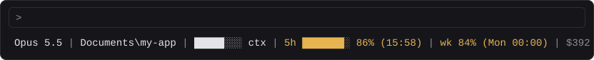
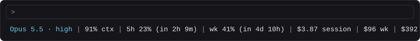
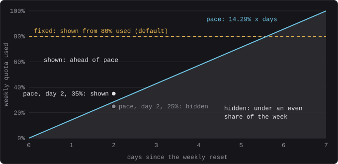
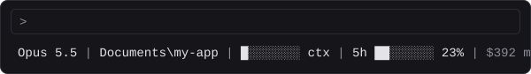
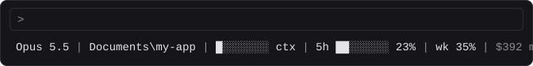

# statusline — configurable Claude Code status line with usage stats

Puts usage numbers into the Claude Code terminal as its status line, the way the VS Code "Claude Code Usage" extension shows them in VS Code. With the default config, early in the week:


The items are model, folder, context, 5-hour quota, weekly quota, month total, week total and session cost. You choose which show, in what order, and how each is formatted on a local config page. Costs are estimates at API list prices, not a bill.

- **Month total**: cost since the first weekly reset that falls in the calendar month (a reset on day 1–7), up to the first weekly reset of the next month. It is a run of whole quota weeks, not a calendar month.
- **Week total**: cost since the current weekly quota window started (`seven_day.resets_at` minus 7 days).

## What it looks like

Every image here is the real `statusline.sh` output for a sample payload, drawn with its terminal colours. `python docs/make_renders.py` rebuilds them.

**Late in the week.** A quota turns amber from 80% used, and its reset time appears from 60% used. The weekly quota has passed its 80% hide threshold, so it is back in the line:



**Customised.** Effort level appended, the model in the accent colour, context as percent left, countdowns instead of clock times, and all three cost totals, with the folder hidden:



## When the weekly quota shows

The weekly quota is the number you least need to see most of the time, so it can stay out of the line until it matters. On the config page, the weekly quota's **Hide until** setting has three modes:

| Mode | Shown when | Setting |
|---|---|---|
| Fixed (default) | used ≥ a fixed % | `qwk.hidefixed`, default 80 |
| Pace | used ≥ pace × days since the weekly reset | `qwk.hidepace`, default 14.29 %/day |
| Off | always | — |

**Pace mode is a cumulative threshold.** The allowance grows through the week, by 100/7 = 14.29% for every day since the weekly reset. The quota stays hidden while you are under an even share of the week, and appears as soon as you reach it or get ahead of it. That is the point where, if you carried on at that rate, you would run out before the reset. The threshold grows continuously, not in daily steps, so half a day in it is 7.1%. Days since the reset are measured from the start of the quota window, which is `seven_day.resets_at` minus 7 days.

| Days since reset | 1 | 2 | 3 | 3.5 | 4 | 5 | 6 | 7 |
|---|---|---|---|---|---|---|---|---|
| Hidden below | 14.3% | 28.6% | 42.9% | 50% | 57.1% | 71.4% | 85.7% | 100% |



Two days in, the limit is 28.6%. At 25% used the weekly quota stays hidden:



At 35% you are ahead of pace, and it appears:



The two modes suit different habits. Fixed mode is simpler: nothing until 80%, then always. Pace mode warns early in the week if you are burning through it, and stays quiet late in the week when a high number is expected. The two lines cross at about 5.6 days. Set the pace to match how you work: 20 %/day spreads the quota over a five-day working week, and 14.29 over all seven days. While the weekly quota is auto-hidden, the config page shows it struck through so you can still drag it into place.

## Install

Windows only. It needs [Git for Windows](https://git-scm.com/download/win) (for Git Bash), plus [Node.js](https://nodejs.org) for the cost totals and Python 3 for the config page.

```
git clone https://github.com/JamesCarron/claude-statusline.git
claude-statusline\Setup_Statusline.bat
```

The setup points `statusLine` in `%USERPROFILE%\.claude\settings.json` at the cloned folder, creates the state folder and prints a test render. If you already have a status line it leaves it alone; run `Setup_Statusline.bat -Force` to replace it (a dated backup of `settings.json` is saved first). It is safe to re-run, so you can run it again after moving the folder. Start a new Claude Code session to see the line.

## Config page

Run `Statusline_Config.bat` (or `python config_server.py`). It starts a stdlib-only server on an ephemeral port and opens the browser. Close the window to stop it.

- The preview is the real `statusline.sh` output, rendered against the last payload Claude Code sent.
- "Simulate usage" sliders set the context, 5-hour and weekly used %, and the days since the weekly reset, for the preview only, so you can see where thresholds kick in. Under them the page shows the weekly threshold at that point in the week, as `statusline.sh` computed it. The days slider moves the preview's clock (`STATUSLINE_NOW`), not the reset. They start at the current usage, and "Reset to current usage" re-reads the latest payload and puts them back. Reset times are never simulated, because the week and month cost windows hang off them.
- Drag segments to reorder them. Press × to hide one. Hidden items wait in a tray; drag one back to show it.
- Click a segment to open its format panel. Options include:
  - name style, and whether to append the effort level;
  - path style, with a maximum length;
  - used or left, shown as percent, bar or both;
  - context, 5-hour and weekly quota: the percentage number only from a threshold ("Show percent from", default 0 = always). Below it, "bar + percent" shows just the bar and "percent" hides the item;
  - reset shown as a clock time, a countdown or hidden, and only once usage reaches a threshold ("Show reset from", default 60% used; 0 = always);
  - weekly quota only, "Hide until": always show it, show it from a fixed % used, or show it only when ahead of a pace of N % per counted day since the reset (default 14.29). "Counted days" is every day or Mon–Fri only; "Count a day" accrues it hour by hour or only once the day is over. Example: 20 %/day, Mon–Fri, once over = shows from 0% on Monday, 20% on Tuesday … 80% on Friday and 100% at the weekend. While it is auto-hidden, the preview shows it struck through so it stays draggable;
  - label text, decimals and thousands separator;
  - colour, including amber once usage passes a threshold.
- Save writes `%LOCALAPPDATA%\Tools\claude_statusline\config.txt`. The status line uses it on its next refresh, so no restart is needed.

## Files

| File | What it is |
|---|---|
| `statusline.sh` | The status line. Git Bash, using bash built-ins only. Reads `config.txt`; every key has a built-in default. `STATUSLINE_PREVIEW=1` prints every item as `id<TAB>colour<TAB>text`, and `STATUSLINE_CONFIG` points it at another config file. |
| `config_server.py` | Config page backend. It holds the item and format spec (`ITEMS`), `DEFAULTS`, validation, and preview rendering by running `statusline.sh`. |
| `config_page.html` | Page template, built per request, so a template edit needs only a browser refresh. It carries neutral light and dark fallback tokens. If a house stylesheet helper (`house_inline.py`) exists in `C:\Tools\brand` or in `STATUSLINE_HOUSE_DIR`, it is inlined and takes precedence. |
| `Statusline_Config.bat` | Launcher. |
| `tests/test_statusline.py` | Checks that the bash defaults equal `DEFAULTS`, plus every format option, order/show, ANSI colour and validation. Run `python -m unittest discover -s tests -v`. |
| `timing_test.js` | Times `statusline.sh` the way Claude Code starts it. Note that it overwrites `last_payload.json` with a synthetic payload until the next real refresh. |
| `docs/make_renders.py`, `docs/img/` | The README images. The script runs the real `statusline.sh` on sample payloads in a temp state folder and draws each line as an SVG, plus the weekly-threshold chart. Re-run it after changing defaults or formats. |
| `Setup_Statusline.bat`, `setup_statusline.ps1` | Setup: Git Bash check, state folder, `settings.json` wiring, test render. See Install and Wiring. |

## Wiring

The setup writes this to `%USERPROFILE%\.claude\settings.json`, with the paths of your Git install and your clone:

```json
"statusLine": {
  "type": "command",
  "command": "\"C:\\Program Files\\Git\\bin\\bash.exe\" \"C:\\path\\to\\claude-statusline\\statusline.sh\""
}
```

Git Bash is called by its full path so that WSL's `bash.exe` is never picked up instead.

## How it works

- Model, folder, context, quotas and session cost come from the JSON Claude Code passes on stdin. Before the first response of a session, items whose data is missing are left out.
- Week and month totals come from `npx -y ccusage@20.0.26 claude daily --json --since <month start>`, summed by `node`. That takes about 7 s, so it runs in the background at most every 5 minutes, or straight away when a window rolls over. It runs only when a total is shown. Results go to `totals.txt` in the state folder, and the status line only reads that file. It needs Node on PATH and network access.
- Each refresh also writes `last_payload.json`, a builtin write that forks nothing, so the config page can preview with real values.
- Colours are ANSI: dim, cyan for accent, yellow for warn.
- **Keep it fork-free.** Each external process (`grep`, `sed`, `date`, ...) costs about 120 ms to start under Git Bash on this machine. A grep/sed version took 8–11 s per refresh; this one takes about 0.3 s.
- **Adding an option**: add the control to `ITEMS`, add its default to `DEFAULTS` and to the `C=(...)` array in `statusline.sh`, render it in the script, then add a case to `Formats.CASES`. The parity test fails if the two default sets drift apart.
